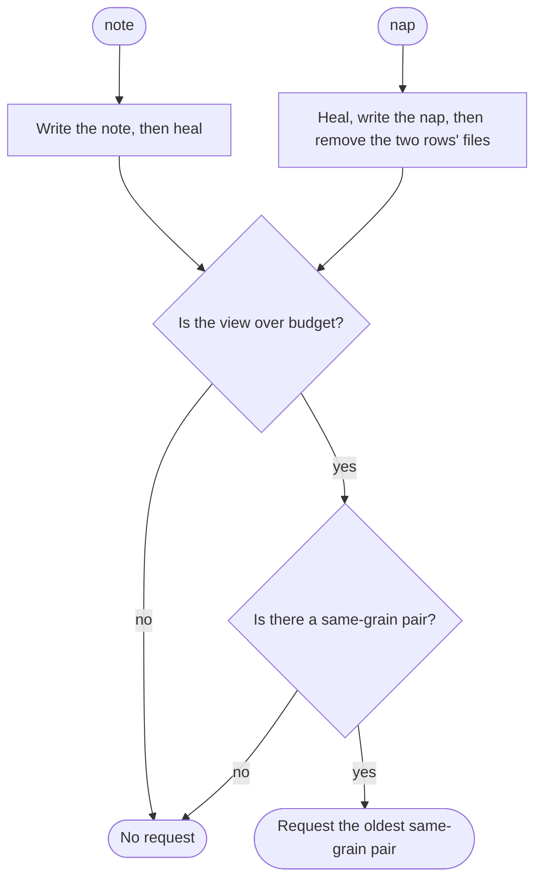
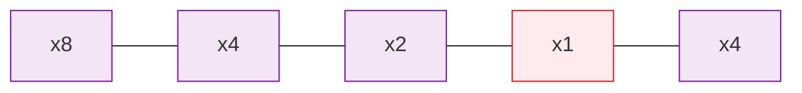

# Folding

The store only grows. What an agent reads must not. **Folding** keeps the [view](wake.md#the-view) near its [wake budget](wake.md#the-wake-budget) by replacing two old rows with one nap, whose caption an agent writes.

## Fold

When a write leaves the view over budget, the script asks for one fold, if a pair exists. The pair is:

- the **oldest** row whose grain is a power of two and that has another row of that grain anywhere later in the listing,
- paired with the **nearest** such later row.

The two rows need not be neighbors: the rule jumps any rows between them, which is what keeps folding going after a merge builds a [wall](#walls). The request quotes the two rows' text and prints a `Run:` line with their ids. The agent supplies the caption. `nap` writes the new nap, removes the files of the two rows it replaced, and, if the view is still over budget, requests the next pair.

Folding counts a nap's grain from its children file, not from its name, and trusts that count even when the name disagrees. A loose note is always grain 1, and the fold scan never opens its file.

`nap` accepts any pair that obeys the same rule, and refuses the rest:

- two rows that hold some of the same memories: `overlapping packs` (overlap is [healing's](merges-and-healing.md) job);
- unequal grains: `not the same grain`;
- a grain that would not be a power of two: `not a power of two`;
- a same-grain row between them: `a nearer row of that grain sits between them`.

Every nap the script writes has a power-of-two grain. Folding never glues a sealed block to a single leftover note: an `x16` next to one `x1` waits for another `x1`.

Fold always removes the two rows' files. It does not keep them on disk because `wake` might [expand](wake.md#expand) the nap later: their memories are in the nap's children file.

### Rows that never fold

Two kinds of row stay listed but are never requested, and never count as the nearer row of their grain:

- a nap whose grain is not a power of two, written by an older driver;
- a nap whose children file is missing or unreadable, because `nap` could not fold it.

Without this, oldest-pair-first would request the same broken row on every `note`, and folding would stop.

## Walls

A **wall** is an older row sitting before a bigger, newer one, such as an `x1` before an `x4`. Walls are why the fold rule pairs a row with its nearest twin, not with its neighbor.

### How walls form

One writer never builds a wall. Grains never increase from older rows to newer ones, each grain of 2 or more appears at most twice, and the oldest row with a twin is always the oldest pair of neighbors.

A merge builds them easily. Say `main` holds `x8 x4 x2 x1`. Two branches that never saw that `x1` each record and fold later notes. After the merge and the next folds:

A late note stamped before an existing nap, a zipper reopen, [surgery](../advanced/surgery.md), or an old odd-grain nap can build the same shape.

### Why a wall stops a neighbors-only rule

Suppose folding paired only neighbors. In the view above, no two neighbors share a grain, so nothing can fold. Nothing ever will. The `x1` would need another `x1` beside it, but new notes land at the end of the list, and the `x4` after it only grows. The `x1` and every row older than it stay in the view forever, over budget, and no request ever names them.

### The fold rule jumps walls

**SumMem pairs the oldest row that has a twin with its nearest twin, however many rows sit between them.**

In the view above, the oldest row with a twin is the first `x4`, and its nearest twin is the last row. They fold across the `x2` and the `x1`, and the new `x8` then pairs with the old one:

| Step | View |
|---|---|
| After the merge | `x8 x4 x2 x1 x4` |
| Fold the two `x4`s, across `x2 x1` | `x8 x8 x2 x1` |
| Fold the two `x8`s | `x16 x2 x1` |

The wall is gone, and the view has a shape one writer could have built.

### Why it does not stall

Because the rule can reach any two rows of the same grain, a fold is possible whenever two such rows exist anywhere in the view. A view with no such pair holds distinct powers of two. Over a 32-row budget, that takes 33 of them: at least 1 + 2 + 4 + … + 2³² notes, about 8.6 billion. Below that, a view over budget always has a pair to fold. [Rows that never fold](#rows-that-never-fold) are outside this count.

That count proves a pair exists. A test checks that the script requests it: [`tests/test_fold_many_writers.py`](https://github.com/Texarkanine/SumMem/blob/main/tests/test_fold_many_writers.py) has three writers record 200 notes between them and merge into a shared `main` at random, with a budget of 6 so that folds happen often. It runs from two fixed random seeds, so every run makes the same choices. After each note and each merge, the test runs every fold the script requests, then checks that a view still over budget has no pair left. At the end it checks that zoom still reaches every note, and that after 64 more notes from one writer, the view is back to a shape one writer could have built.

### Why oldest pair first

Jumping walls was the requirement. Which pair to fold first was the choice. Six rules were simulated on the real driver: 4 writers, 1,500 notes, merges after 8% of notes, budget 32, two seeds.

| Rule | Result |
|---|---|
| Neighbors only (the old rule) | Stalled over budget after most merges. |
| Fold unequal grains | Wrote packs of 3, 35, and 1,371 notes. |
| Skip, smallest grain first | Folded the newest notes first: no recent note stayed word for word. |
| Pull back, never jump a bigger row | Still stranded rows, and listed far more notes out of order, because a stranded row gets jumped again and again. |
| Fewest walls, any jump | Worked, with more notes out of order and fewer recent notes word for word. |
| **Skip, oldest pair first** | **Never stalled, kept recent notes word for word, and listed the fewest notes out of order.** |

On a view where grains never increase from older rows to newer ones, oldest-pair-first is exactly the neighbors rule, so one writer sees the same folds as before. After a merge it keeps that one-writer shape most of the time.

The cost: a nap's notes are no longer guaranteed to be contiguous in time. At a budget of 32, about a tenth of notes list above an older note. Concurrent writers already broke strict order, since a merged branch's nap spans notes from `main`.
