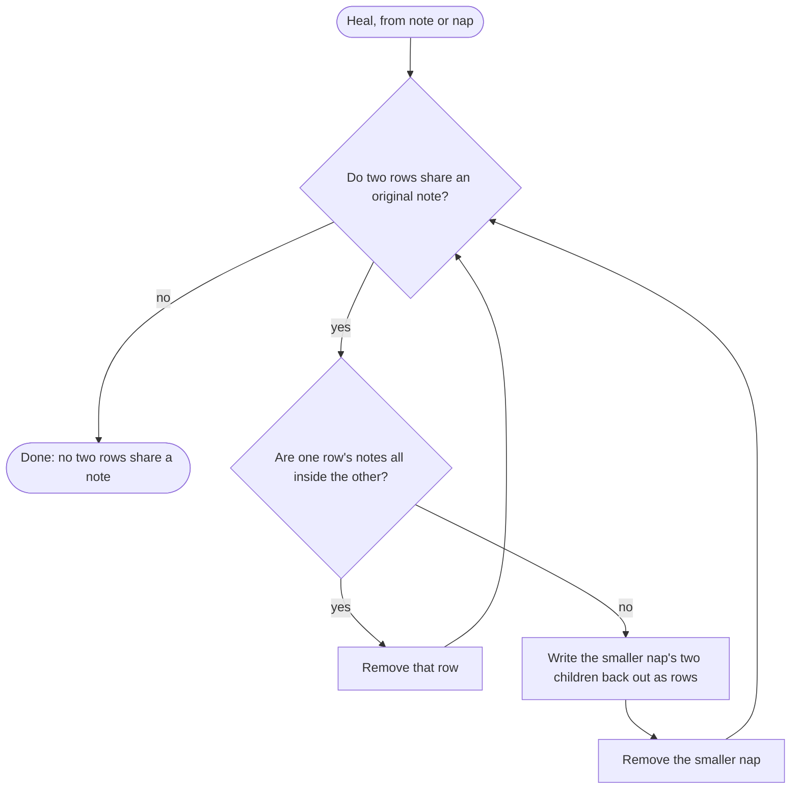

# Merges and Healing

A git merge of two stores is the union of their files. Nothing in a store is ever edited, so the union never conflicts. It can, however, list the same notes more than once. **Healing** puts the view back into a clean state: no two rows share an original note. It never loses one.

## What a merge can leave

Each shape comes from branches that did not see each other's work:

| Shape | How it happens |
|---|---|
| Two naps with the same content id | Two branches got the same fold request, and each writer worded its own caption. The request is deterministic, so this is the ordinary result of two branches recording notes near the budget. The variant tags differ, so git keeps both. |
| Two naps whose notes overlap | Two branches grouped some of the same notes differently. |
| A loose note beside a nap that holds it | The same note file is back in two places. Say a branch keeps going after its first pull request was squash-merged, and `main` folds that pull request's note in the meantime. Merging the branch again brings the loose file back, beside the nap. A cherry-pick, a revert, or a heal on another branch that opened a nap can do the same. |
| Two loose notes with the same text | Two writers recorded the same line, byte for byte. This is rare. Notes are free text of up to 280 bytes by default, usually written by a language model, and two independent writers almost never produce the same line. |

The last two are one repair: a note whose text another row already holds. That repair earns its place through the third shape, not the fourth. Two writers seldom write the same sentence, but git often puts one note in two places.

## Heal

**Heal** is the repair for all four. It loops until no two rows share an original note:

Every step either removes a row whose notes are all still held elsewhere, or replaces a nap with its own children. No step changes which notes the store holds. [Why It Converges](../how-it-works/theory.md#what-each-operation-does-to-meaning) states that as a property, and [Why Writers Never Conflict](../how-it-works/no-conflicts.md#summaries-that-overlap) walks through both branches of the diagram with pictures.

The opening-up branch is also called the **zipper**: it unzips the smaller nap so the larger one can keep what they share.

### A note held twice

A note's content id comes from its text, so a loose note and any other row holding the same text share that note.

- Beside a nap that holds it, the loose note is removed. The nap keeps it.
- Beside a loose note with the same text, the earlier filename is removed and the later one stays.

The same repair runs when an agent records a sentence the store already holds, because `note` heals right after it writes. `note` prints `Saved.` either way. That is true of what the store remembers, not of the files:

| The sentence was already | On disk after `note` |
|---|---|
| Inside a nap | Nothing has changed. `note` wrote the new file, and heal removed it. |
| A loose note | The old file is gone and the new one stays, so the note now lists at today's date. |

Two copies of one sentence are one fact, so they can never fold together. A nap of them would claim grain 2 for one note. `nap` refuses any pair whose notes overlap.

### Same content id

Two naps with the same content id hold the same notes. Heal keeps the one whose filename sorts last. Their [names](store.md#nap-names) differ only in the variant tag, so the survivor is chosen by content, not by who wrote last or merged last. Every clone that has both files keeps the same one. Its `.tree` and `.summ` are one pair and always survive together.

Until the next heal, `wake` can print both rows, with one id.

### Overlap

When two naps share some notes but neither holds all of the other's, heal opens the smaller one into its children and removes it. Repeated, this drops any child that is now a subset of the larger nap and keeps the rest.

## When heal runs

| Command | Heal |
|---|---|
| `note` | After writing the new note, before checking the budget. |
| `nap` | Before resolving the ids the agent passed. |
| `wake`, `zoom`, `recall` | Never. Reading never waits on a repair. |

Because `nap` heals first, an id the agent copied before a merge can disappear. Then `nap` fails with `unknown id` and folds nothing. The notes still live in the row that survived, and the next fold request names current ids.

## The lock

`note` and `nap` run heal, the fold scan, and the write under one lock on the machine. It is a lock on the store's `naps/` directory where the system allows one, and otherwise a lock file in the operating system's runtime directory. Neither is committed. Two clones never wait on each other; git merge remains the only coordination between them. `wake` never takes the lock.

While the lock is held, each children file is parsed at most once per command. Heal, the fold scan, and `nap` share that parse. A file the command writes is parsed again when next read. Nothing is cached outside the lock: tests call these functions directly and edit files between calls.

## What healing does not do

Heal makes the view clean, not canonical. Two clones that have seen the same notes may still group them differently: one may hold `ABCD` beside `EF` where the other holds `AB`, `CD`, and `EF`. Both are correct. Rebuilding one canonical grouping after every merge is [not this algorithm](not-yet.md#not-this-fold).
