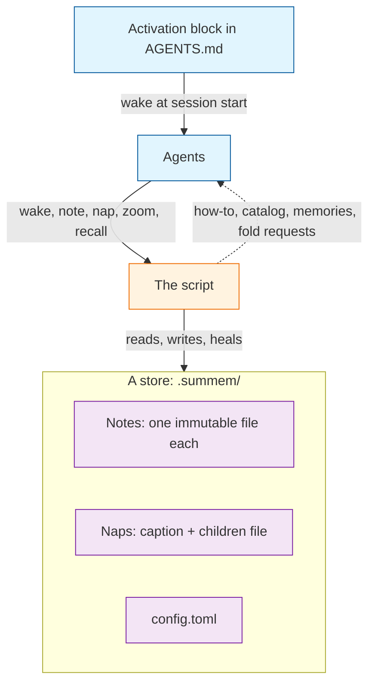

# Architecture

SumMem is a grow-only set of short facts in a git repository, plus a listing of those facts that gets shorter as they age. Agents never edit the files. They run a script, and the script owns every path, name, timestamp, and hash.

## Store, driver, and activation

These are three different things.

- A **store** is the data: a `.summem/` directory of notes, naps, and settings. See [The Store](store.md).
- The **driver** is the script agents run. Creating a store creates its directories and settings file; it never places or overwrites the driver. This repository keeps one script at its root, and its stores link to it.
- **Activation** is the block at the top of committed `AGENTS.md`. `init` prints a starting version. Once inserted, the block is the repository's own policy, and its write rule is the repository's to edit. The script never reads `AGENTS.md`, so it never puts its default back over an edited block. Having the driver in the repository is not activation. Command recipes live in the how-to that root `wake` prints, not in the block.

The on-disk format can change later only if agents still never touch store files.

## Glossary

| Term | Meaning | Defined in |
|---|---|---|
| note | One memory: one line, in one immutable file | [The Store](store.md#notes) |
| nap | A caption plus a children file, standing for two rows of the same grain | [The Store](store.md#naps) |
| caption | A nap's one-line summary, in its `.summ` file | [The Store](store.md#naps) |
| children file | A nap's `.tree` file: its two children, down to every original note | [The Store](store.md#the-children-file) |
| content id | A hash of the original notes a row stands for | [The Store](store.md#identity) |
| variant tag | The last field of a nap's name: a hash of its two files | [The Store](store.md#nap-names) |
| view, row | The listing `wake` prints, and one entry in it | [Wake](wake.md#the-view) |
| grain | How many original notes a row stands for | [Wake](wake.md#grain) |
| memory line | How `wake`, `zoom`, and `recall` print one row | [Wake](wake.md#memory-lines) |
| wake budget | The number of rows the view aims for | [Wake](wake.md#the-wake-budget) |
| fold | Replacing two same-grain rows with a nap | [Folding](folding.md#fold) |
| wall | An older row before a bigger, newer one | [Folding](folding.md#walls) |
| expand | `wake` opening naps in memory to fill spare lines | [Wake](wake.md#expand) |
| heal, zipper | Removing rows whose memories another row already holds, after a merge or a repeated `note` | [Merges and Healing](merges-and-healing.md) |
| catalog | Root `wake`'s list of the other stores | [Wake](wake.md#a-root-wake) |

## Invariants

These look optional and are not.

- **The script is the only writer.** Agents never create, edit, or delete store files.
- **Recording a note commutes.** Two notes are two paths. There is no next id and no shared index that every write updates.
- **Order is in the filename.** Writer time for notes; the oldest note's time for naps. Never `git log`.
- **Children files are written once and are canonical.** The same tree dumps to the same bytes. Fold writes a new file; it never patches one.
- **Merges union, then heal.** Different bytes are different paths, and git merges them as a set. The next `note` or `nap` heals the view so no two rows share a note, and the file count returns to the size of the view. See [Merges and Healing](merges-and-healing.md).
- **Every nap's grain is a power of two.** Fold pairs equal grains, oldest pair first, across walls. See [Folding](folding.md#fold).
- **Zoom is a property of the current commit.** Every sentence a zoom can owe is in a file at the tip.
- **Wake never blocks.** It never refuses to print, never drops rows to fit the budget, and degrades a damaged caption instead of failing.
- **The wake budget is a target.** Writes move the view toward it; a merge can exceed it until the next writes fold.
- **Empty packages stay empty.** The root store is created automatically; every other store needs `start`. Walking up never creates a store.
- **The root pushes; other stores pull.** Root `wake` catalogs other stores; an agent loads one with `wake --path`.
- **Settings live in the store,** not in the environment. Missing settings take the script's defaults.
- **Rows are named by content, never by position.** Notes print with a day, naps with a unique id prefix. Ranges are rejected.
- **Personal and machine facts stay out.** A store holds facts about its directory tree. That is the product's intent and the default write rule. The write rule is the repository's own text; the script never reads it.
- **A driver older than five-part nap names is not a supported concurrent writer.**

## What this is not

This repository also keeps task notes under `memory-bank/`. That is a different system: scoped to one task, and archived when the task ends.

SumMem is also not:

- one growing log that every note appends to;
- a lease, a primary agent, or a custom merge driver;
- git history as the zoom tree;
- harness hooks as the way memory loads;
- a package manifest as a scope.

## Change surfaces

| If you are changing | Read |
|---|---|
| What an agent is told, or may type | The operator command table (`usage_text`, mirrored in [Commands](../user-guide/commands.md)), the activation block (write rule and wake handoff), and root-wake Usage (argv, grammar, writer-only). Do not leak store paths into the agent interface. CLI output stays silent on git. Usage treats the files the script wrote as part of the agent's work, not a separate publish step. |
| How notes land under concurrency | [The Store: Notes](store.md#notes). Recording a note must still commute. |
| How summaries and originals survive squash | [The Store: Naps](store.md#naps) and [Zoom and Recall](zoom-and-recall.md#zoom). |
| Nap filenames or the children file format | [The Store: Nap names](store.md#nap-names) and [The children file](store.md#the-children-file). Then [Store Files](../advanced/store-files.md), and `migrate.py` if old names must be rewritten ([Upgrading](../user-guide/upgrading.md#older-nap-files)). Do not rename files by hand. |
| The wake budget, fold rule, or decay shape | [Wake: The wake budget](wake.md#the-wake-budget) and [Folding](folding.md). The walk-through on [How SumMem Works](../how-it-works/index.md) must still be true. |
| Merge behavior, or any file that every note would update | [Merges and Healing](merges-and-healing.md). The worked merge in [Why Writers Never Conflict](../how-it-works/no-conflicts.md) must still be true. |
| How wake, zoom, or recall print or search | [Wake](wake.md) and [Zoom and Recall](zoom-and-recall.md). |
| Repository vs package vs machine scope, or how a directory becomes a store | [The Store: More than one store](store.md#more-than-one-store) and [Wake: A root wake](wake.md#a-root-wake). |
| A different on-disk backend | The agent interface must not change, and every store role must still exist. See [Not Yet](not-yet.md). |
| The docs site | [Docs Site](../contributing/docs.md). Give each fact one home and link to it. |
