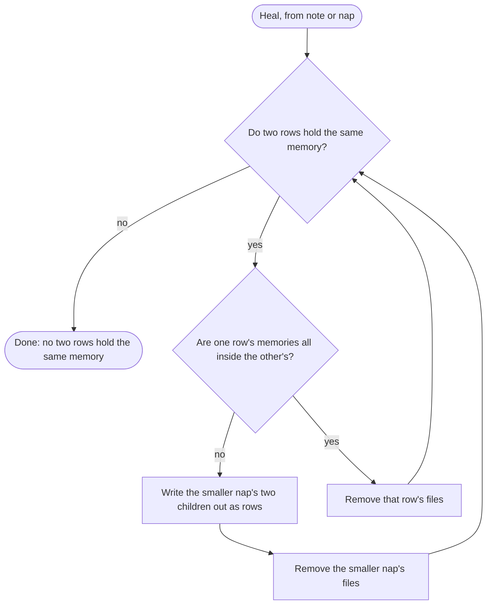

# Merges and Healing

A git merge of two stores is the union of their files. Nothing in a store is ever edited, so the union never conflicts. It can, however, leave two rows that hold the same memory. **Healing** puts the view back into a clean state, where no two rows hold the same memory. It removes files, never memories.

## What a merge can leave

Each shape comes from branches that did not see each other's work:

| Shape | How it happens |
|---|---|
| Two naps with the same content id | Two branches got the same fold request, and each writer worded its own caption. The request is deterministic, so this is the ordinary result of two branches recording notes near the budget. The variant tags differ, so git keeps both. |
| Two naps that hold some of the same memories | Two branches grouped some of the same notes differently. |
| A loose note beside a nap that already holds its memory | One note ends up in the store twice: as its own file, and inside a nap. Say a branch keeps going after its first pull request was squash-merged, and meanwhile `main` folds that pull request's note into a nap. Merging the branch again re-adds the note's file, beside the nap. A cherry-pick, a revert, or a heal on another branch that opened a nap can do the same. |
| Two loose notes with the same text | Two writers recorded the same line, byte for byte. This is rare. Notes are free text of up to 280 bytes by default, usually written by a language model, and two independent writers almost never produce the same line. |

The last two get one repair: a loose note whose memory another row already holds. The third shape is why that repair matters. Two writers seldom write the same sentence, but git often puts one note in two places.

## Heal

**Heal** is the repair for all four. It finds two rows that hold the same memory, and:

- if one row's memories are all inside the other's, it removes that row's files;
- otherwise it opens the smaller nap: it writes the nap's two children out as rows, then removes the nap's files.

It repeats until no two rows hold the same memory.

Every step either removes a row whose memories another row still holds, or replaces a nap with its own children. No step changes which memories the store holds. [Why Memories Converge](../how-it-works/why-memories-converge.md#what-each-operation-does-to-meaning) states that as a property, and [Why Writers Never Conflict](../how-it-works/no-conflicts.md#summaries-that-overlap) walks through both branches of the diagram with pictures.

The opening branch is also called the **zipper**: it unzips the smaller nap so the larger one can keep what they share.

### A note held twice

A note's content id comes from its text, so a loose note holds the same memory as any other row with that text.

- Beside a nap that holds that memory, the loose note's file is removed. The nap still holds the memory.
- Beside a loose note with the same text, the file with the earlier name is removed, and the later one stays.

The same repair runs when an agent records a sentence the store already holds, because `note` heals right after it writes. `note` prints `Saved.` either way. That is true of what the store remembers, not of the files:

| The sentence was already | On disk after `note` |
|---|---|
| Inside a nap | Nothing has changed. `note` wrote a new file, and heal removed it. |
| A loose note | The older file is gone and the new one stays, so the memory now lists at today's date. |

Two copies of one sentence are one memory, so they can never fold together. A nap of them would claim grain 2 for one memory. `nap` refuses any pair of rows that hold the same memory.

### Same content id

Two naps with the same content id hold the same memories. Heal keeps the one whose filename sorts last. The [names](store.md#nap-names) differ only in the variant tag, a hash of each nap's files, so the survivor is chosen by what the naps contain, not by who wrote last or merged last. Every clone that has both naps keeps the same one. A nap's `.tree` and `.summ` files are one pair, kept or removed together.

Until the next heal, `wake` can print both rows, with one id.

### Overlap

When two naps hold some of the same memories but neither holds all of the other's, heal opens the smaller one: it writes the nap's children out as rows and removes the nap's files. Of two naps the same size, it opens the one whose name sorts first. Repeated, this removes each child whose memories the other nap already holds, and keeps the rest.

## When heal runs

| Command | Heal |
|---|---|
| `note` | After writing the new note, before checking the budget. |
| `nap` | Before resolving the ids the agent passed. |
| `wake`, `zoom`, `recall` | Never. Reading never waits on a repair. |

Because `nap` heals first, an id from a fold request can be gone by the time a later `nap` runs: a merge landed in between, or another agent on the machine ran the same request first. If that pair is already the two children of a nap, `nap` succeeds, prints `Saved.`, and then whatever fold is actually left. The memories stay in the nap that won. An id the store does not have is `unknown id`.

## The lock

`note` and `nap` run heal, the fold scan, and the write under one lock on the machine. It is a lock on the store's `naps/` directory where the system allows one, and otherwise a lock file in the operating system's runtime directory. Neither is committed. Two clones never wait on each other; git merge remains the only coordination between them. `wake` never takes the lock.

While the lock is held, each children file is parsed at most once per command. Heal, the fold scan, and `nap` share that parse. A file the command writes is parsed again when next read. Nothing is cached outside the lock: tests call these functions directly and edit files between calls.

## What healing does not do

Heal makes the view clean, not canonical. Two clones that have seen the same memories may still group them differently: one may hold `ABCD` beside `EF` where the other holds `AB`, `CD`, and `EF`. Both are correct. Rebuilding one canonical grouping after every merge is [not this algorithm](not-yet.md#not-this-fold).
