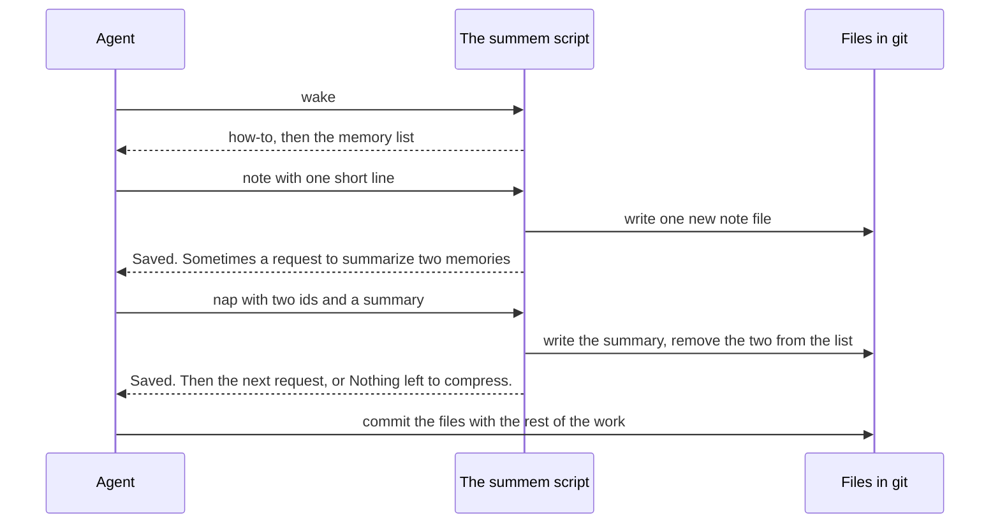
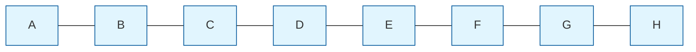
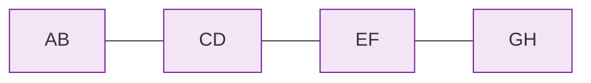
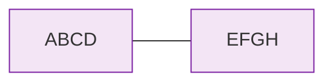
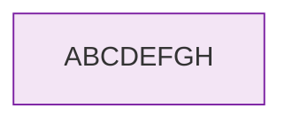

# How SumMem Works

SumMem keeps a repository's memory as small files in git. It shows agents a short list of those memories. The list stays short because old memories fold into one-line summaries, and each summary keeps the original memories inside it.

This page walks through a small store in the SumMem repository, then shows the files on disk.

## The cycle



- **`wake`** prints the memory list. An agent runs it once, at the start of a session.
- **`note`** records one line. If the list is now too long, `note` asks the agent to summarize two memories.
- **`nap`** writes that summary. The agent chooses the words. SumMem chooses which two memories, and names every file.
- **`zoom`** opens a summary back into the two memories under it.
- **`recall`** searches the remembered text, word for word.

Agents never touch the files. They run the script, and the script writes, names, and removes every file. The agent commits those files with the rest of its work.

## A walk through one store

The SumMem repository has a small store in `dogfood/`. Its list is capped at 4 lines, and it holds the letters `a` to `h`:

```console
$ .summem/summem wake --path dogfood
x4 01b18901: a, b, c, d
x2 abd13ab8: e & f
x1 2026-08-19: g
x1 2026-08-19: h
You are up to speed.
```

Each line starts with its **grain**: how many original memories it stands for. An `x1` line is a single memory, called a **note**, shown with the day it was written. An `x2` or `x4` line is a summary, called a **nap**. A nap shows an id instead of a day.

Record `i`:

```console
$ .summem/summem note --path dogfood i
Saved.

Summarize these two into one line of at most 280 characters.
Keep what has lasting effect, drop what does not. Invent nothing.

  g
  h

Run: .summem/summem nap --path dogfood 3fc87382 fa6da6a9 "<your line>"
```

The list would now have 5 lines, one more than its cap. So `note` asks for a nap. SumMem picks the oldest two memories of the same grain, `g` and `h`. It prints the command to run, with a placeholder for the summary.

Write the summary:

```console
$ .summem/summem nap --path dogfood 3fc87382 fa6da6a9 "g & h"
Saved.

Nothing left to compress.
```

The list is back within its cap:

```console
$ .summem/summem wake --path dogfood
x4 01b18901: a, b, c, d
x2 abd13ab8: e & f
x2 cfbf987a: g & h
x1 2026-11-06: i
You are up to speed.
```

`g` and `h` are now one `x2` line. Nothing was lost. If an agent needs more than the summary says, it can zoom in:

```console
$ .summem/summem zoom --path dogfood cfbf987a
x1 2026-08-19: g
x1 2026-08-19: h
```

`recall` searches every remembered line, including the ones inside summaries:

```console
$ .summem/summem recall --path dogfood 'c|f'
x4 01b18901: a, b, c, d
x2 abd13ab8: e & f
x2 bbd5a70e: c & d
x1 2026-08-19: c
x1 2026-08-19: f
```

## Only equal grains fold

SumMem only folds two memories of the same grain: two notes, two `x2` naps, two `x4` naps. If that reminds you of the game [2048](https://classic.play2048.co/), it should.

Here is one writer with eight notes, `A` to `H`, oldest first. Pretend the cap is 1, so every possible pair gets folded. Each letter is one note. A box `AB` is the nap of those two notes.



The oldest pairs of notes fold, four times:



Then the oldest pairs of `x2` naps, twice:



Then the last pair:



Eight notes became one line. Zoom still opens `ABCDEFGH` into `ABCD` and `EFGH`, and so on down to the letters.

With a real cap, such as the default of 32 lines, the newest memories stay as single notes and the oldest become summaries of summaries. Each level of nesting doubles the grain, so 2048 notes are only eleven levels deep.

## On disk

Here is what that walk changed, before it was committed:

```console
$ git status
...
Changes to be committed:
  new file:   dogfood/.summem/naps/20260819T213123Z-5e64febd8268823c-cfbf987aa25d8492-2-8f8111f124e6075e.summ
  new file:   dogfood/.summem/naps/20260819T213123Z-5e64febd8268823c-cfbf987aa25d8492-2-8f8111f124e6075e.tree
  deleted:    dogfood/.summem/notes/20260819T213123Z-5e64febd8268823c
  deleted:    dogfood/.summem/notes/20260819T213139Z-e82628a6be85430a
  new file:   dogfood/.summem/notes/20261106T202332Z-6096c8ccfefb4c58
```

- The new file under `notes/` is `i`. A note is one file holding one line. Its name is the time it was written, in UTC, plus random characters.
- The two deleted notes are `g` and `h`.
- The two new files under `naps/` are the nap. They share one name:
    - The `.summ` file holds the summary, `g & h`. This is what `wake` prints.
    - The `.tree` file holds the original notes that the summary stands for.

The nap's name starts with the time of its oldest note, `g`. That keeps the nap where `g` was in the list, rather than at the time the summary was written.

The `.tree` file is one line of JSON. Here it is, spread out:

```json
{
  "c": [
    {
      "name": "20260819T213123Z-5e64febd8268823c",
      "text": "g",
      "type": "note"
    },
    {
      "name": "20260819T213139Z-e82628a6be85430a",
      "text": "h",
      "type": "note"
    }
  ]
}
```

The `x4` nap `a, b, c, d` holds two naps, `a & b` and `c & d`, and each of those holds its two notes. Every original line lives in some file at the tip of the branch. Zoom and recall need no git history, so a fresh clone or a squash-merge keeps everything.

## Where next

- [Why Writers Never Conflict](no-conflicts.md): what happens when many agents write at once and their branches merge.
- [Why It Converges](theory.md): the reasoning behind that, from a shoebox of receipts to a proof.
- [Quickstart](../user-guide/quickstart.md): set it up in your repository.
