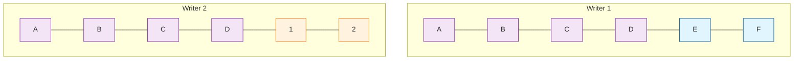
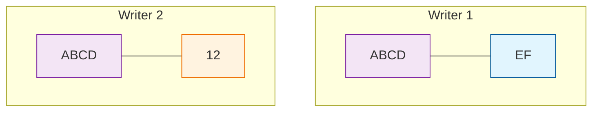
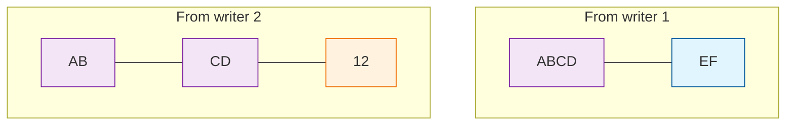
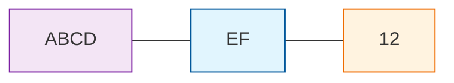
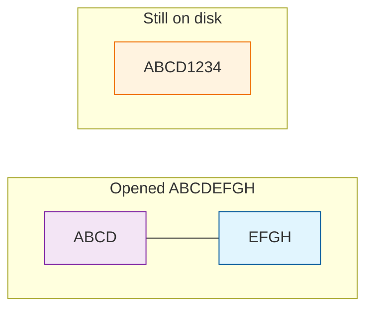
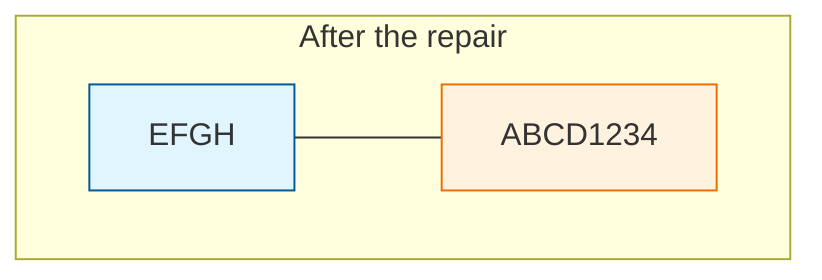

# Why Writers Never Conflict

Many agents can write to one SumMem store at the same time: in different branches, on different machines, with no lock between them. When their branches merge, git reports no conflict in the store, and no memory is lost.

## A real merge

Alice and Bob branch from the same store. It holds four notes, `a` to `d`, and its wake budget is 4 lines. Each of them adds one note. That puts the list over its budget, so each is asked to fold `a` and `b`, and each writes their own summary.

On Alice's branch:

```console
$ .summem/summem note "e (alice)"
Saved.

Summarize these two into one line of at most 280 characters.
Keep what has lasting effect, drop what does not. Invent nothing.

  a
  b

Run: .summem/summem nap 2bba5f0f 50782259 "<your line>"
$ .summem/summem nap 2bba5f0f 50782259 "a and b (alice's words)"
Saved.

Nothing left to compress.
```

Bob does the same on his branch. His note is `1 (bob)` and his summary is `a, b (bob's words)`.

Now merge Bob's branch into Alice's:

```console
$ git merge bob
Merge made by the 'ort' strategy.
 ...
 3 files changed, 3 insertions(+)
```

The merge is clean. Bob's branch added three files that Alice's branch does not have: his note and the two files of his nap. Both branches deleted the same two note files, `a` and `b`, whose text now lives in their naps.

Right after the merge, `wake` lists both summaries. They have the same id, because a nap's id comes from the notes under it, not from the summary's words:

```text
x2 95cfbdf3: a, b (bob's words)
x2 95cfbdf3: a and b (alice's words)
x1 2026-11-06: c
x1 2026-11-06: d
x1 2026-11-06: e (alice)
x1 2026-11-06: 1 (bob)
```

The next `note` or `nap` on that branch fixes it. One summary stays, and the other's files are removed:

```text
x2 95cfbdf3: a and b (alice's words)
x1 2026-11-06: c
x1 2026-11-06: d
x1 2026-11-06: e (alice)
x1 2026-11-06: 1 (bob)
x1 2026-11-06: f (alice)
```

SumMem did not keep Alice's summary because she merged, or because she wrote last. It kept the summary whose file name sorts last. Every clone that merges the same files keeps the same one. [Why It Converges](why-it-converges.md#a-max-register-for-captions) explains why that rule is safe.

## Why git has nothing to conflict on

Git reports a conflict when two branches change the same file in different ways. SumMem never does that:

- **Every write is a new file.** A note's name is the UTC time it was written plus 16 random hex characters. Two writers do not pick the same name.
- **No file is ever edited.** Notes, summaries, and children files are written once and never changed. A correction is a new note.
- **Same name means same bytes.** A [nap's name](../architecture/store.md#nap-names) is built from what is in it: the notes under it, its summary, and its children. Two writers who write the same nap write the same file, byte for byte. Two writers who word the summary differently write two different files.
- **Deletions never clash.** Git can only conflict on a deletion if the other branch edited that file, and no one edits store files. When two branches fold the same memories, both delete the same files, which git also accepts.
- **There is no shared index.** No counter, log, or table of contents is updated on every write. A file like that is exactly what two writers would both edit.

So merging two stores gives the union of their files. The one store file people edit by hand, `config.toml`, merges like any other text file.

## What the next write tidies up

A merge can leave two lines in the list that hold some of the same memories. Nothing is lost, and the next `note` or `nap` puts it right. `wake` never changes files, so reading never waits for repair.

Here are the two common shapes. [Merges and Healing](../architecture/merges-and-healing.md#what-a-merge-can-leave) lists every one.

The list can also be longer than its budget right after a merge. `wake` still prints every line, and the next `note` or `nap` asks for folds until the list is back within its budget.

### Two summaries of the same notes

This is the case from the merge above. The summary whose file name sorts last stays, and the other is removed.

### Summaries that overlap

Here two writers start from the same notes `A B C D`. Writer 1 goes on with letters `E F`. Writer 2 goes on with numbers `1 2`.



Each writer folds equal grains, as on [How SumMem Works](index.md#only-equal-grains-fold). Both can build `ABCD`. Writer 1 then has `ABCD` next to `EF`, and writer 2 has `ABCD` next to `12`. SumMem does not fold an `x4` with an `x2`, so each waits there.



Suppose writer 2 had not yet folded `AB` with `CD`. The merge is the union of both lists: the parts and the whole.



`AB` and `CD` sit entirely inside `ABCD`, so SumMem removes their files: `ABCD` holds every memory they held. What is left does not overlap:



Now suppose each writer went further, and folded a continuation of four notes onto `ABCD`. The merge brings two `x8` naps. They share `A B C D`, but neither sits inside the other:

```mermaid
flowchart TB
    classDef shared fill:#f3e5f5,stroke:#7b1fa2;
    classDef w1 fill:#e1f5fe,stroke:#01579b;
    classDef w2 fill:#fff3e0,stroke:#ef6c00;

    subgraph whole1["ABCDEFGH"]
        direction LR
        P1A["A"]:::shared --- P1B["B"]:::shared --- P1C["C"]:::shared --- P1D["D"]:::shared --- P1E["E"]:::w1 --- P1F["F"]:::w1 --- P1G["G"]:::w1 --- P1H["H"]:::w1
    end
    subgraph whole2["ABCD1234"]
        direction LR
        P2A["A"]:::shared --- P2B["B"]:::shared --- P2C["C"]:::shared --- P2D["D"]:::shared --- P21["1"]:::w2 --- P22["2"]:::w2 --- P23["3"]:::w2 --- P24["4"]:::w2
    end
```



SumMem opens `ABCDEFGH` into its two children, then removes `ABCDEFGH`'s files:



`ABCD` now sits entirely inside `ABCD1234`, so its files are removed too. Every letter and number is still in exactly one place. No memory was lost.



SumMem calls this repair the **zipper**. It runs under a lock on the one machine, during one `note` or `nap`. The lock is not a file in git, and two clones never wait on each other.

## Squash, rebase, and fresh clones

A squash-merge keeps only the files at the tip of the branch. That is enough. Every original memory is either a note file or inside a nap's children file at the tip. `zoom` and `recall` read only those files and never git history, so a shallow clone has the whole memory.

The order of memories comes from their file names, not from commit times. A rebase, a squash, or a late merge does not reorder them.

## The short version

The memories form a set that only grows. A merge takes the union. Folding and repair change how the set is grouped and worded, never which memories are in it. For why every clone that has seen the same notes agrees on what is remembered, see [Why It Converges](why-it-converges.md).
