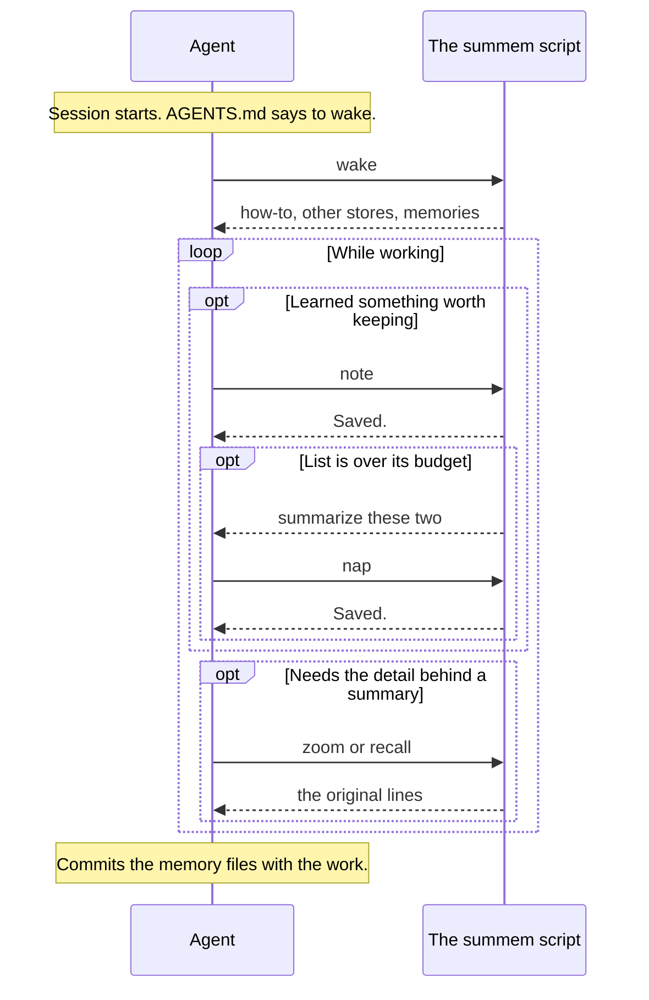

# User Guide

SumMem has two kinds of user. You look after the repository: you set SumMem up once and decide what the repository remembers. Agents use it in every session.

## What you do

- **Once:** put the script in the repository and the activation block in `AGENTS.md`. See [Quickstart](quickstart.md).
- **When you choose:** change what the repository remembers, in [What to Remember](write-rule.md). Give a package its own memory, in [Stores and Settings](stores.md).
- **In review:** memory files arrive in pull requests like any other change. See [Working with Git](git.md).
- **When a new version ships:** copy the newer script. See [Upgrading](upgrading.md).

## What agents do

Agents learn the commands from SumMem itself. The root `wake` prints a short how-to before the memories, so you do not need to teach them. [Commands](commands.md) covers the same commands for people.

## What next

- [Quickstart](quickstart.md): set up a repository.
- [How It Works](../how-it-works/index.md): see one store fold and open up again.
- [Troubleshooting](troubleshooting.md): what an error message means.
