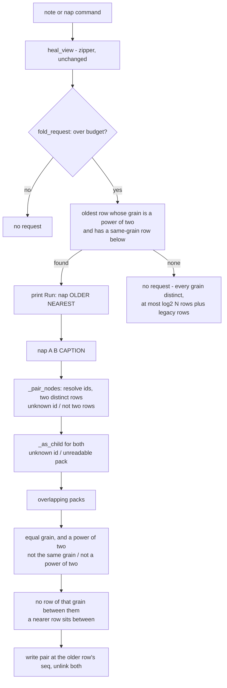

# Task: Middle orphans — fold never strands a row

* Task ID: middle-orphans
* Complexity: Level 3
* Type: bug fix (core fold algorithm)

Today `fold_request` only pairs equal-grain **neighbors**. Several writers can leave an older row next to a bigger, newer one (a **wall**) through a merge, a late note, a zipper reopen, or surgery. The row before the wall never meets an equal neighbor again, so it and every older row become dead wake lines. Then each new note gets folded early to pay for them.

The fix:

- `fold_request` names **the oldest row that has a row of the same grain anywhere below it, paired with the nearest such row**. That is a skip fold, oldest pair first.
- `nap` accepts exactly those pairs. It refuses unequal grains, pairs with a nearer same-grain row between them, and any pair whose grain is not a power of two.
- Wake sorts rows opened in memory by date.
- Legacy non-power-of-two packs are left alone.

No on-disk change, no migration: existing stores heal through normal fold requests.

Tests already on this branch:

- in `tests/test_middle_orphans.py`, five red stranding tests (B6), the red odd-grain test (replaced in Unit 3), and the green oldest-pair guard (B1);
- the red `tests/test_nap_reject.py::test_nap_of_unequal_grains_rejected_without_writing` (B9).

Research, simulations, prototype patch, and visual review: `memory-bank/active/creative/fold-research/` (start with its `README.md`; open `fold-review.html` in a browser).

## Pinned Info

### Fold request and nap, after the change

The two paths every unit touches. Pinned because the order of checks in `nap` is load-bearing: four existing tests depend on `unknown id`, `unreadable pack`, and `overlapping packs` winning over the new grain refusals.

## Component Analysis

### Affected Components

- **`summem` · `fold_request` (1225–1261)**: today it picks the oldest equal-grain neighbors when over budget. Change: oldest row, with a power-of-two grain, that has a same-grain row anywhere below it, paired with the nearest one. Remaining-count text, the `Run:` line, `--path`, and the empty return stay the same.
- **`summem` · `_adjacent_nodes` (836–848) → `_pair_nodes`**: today it resolves ids to two neighbor rows, any grain. Change: return the indices `(lo, hi)` of two distinct rows, nearest pair among duplicate-id hits, older first. It refuses the same row twice. The grain and nearest checks move into `write_nap`, after child loading.
- **`summem` · `write_nap` (851–872)**: today it loads children, refuses overlap, and writes. Change: after the overlap check, refuse unequal grains, refuse grains that aren't a power of two, and refuse a pair with a row of that grain between them. Update the docstring.
- **`summem` · new `_is_pow2(n)` and `_nearest_twin(grains, i)`**: pure helpers. `_nearest_twin` returns the first row below `i` with the same grain. Both are shared by the picker and `write_nap`, so the picker's pair is accepted by construction.
- **`summem` · new `_fold_pair(grains)`**: pure. It returns the index pair the picker requests, or `None`. `fold_request` maps it back to view rows.
- **`summem` · `ProjectedNode` (185), `_projected_child` (1103), `expand_frontier` (1047–1074)**: today opened children are spliced in place and only a seconds stamp is carried. Change: a `seq` slot holds the oldest note's `{stamp}-{rand}`, and rows are sorted by `seq` after each split.
- **`summem` · `usage_text` (1387)**: "fold two adjacent ids" becomes "fold two ids of the same grain".
- **`tests/gitutil.py`**: `fold_ids` is a left fold that writes 3-, 5-, 7-packs. Change: a balanced fold, plus shared `plant_pack` and `obey_folds` helpers moved from `test_middle_orphans.py`.
- **Tests**: `test_zipper.py`, `test_branch_pack_merge.py`, `test_wake_expand.py`, `test_nap.py`, `test_cli.py`, `test_fold.py`, `test_middle_orphans.py`, and new `test_fold_many_writers.py`.
- **Docs**: `README.md`, `docs/architecture/index.md`, `docs/theory.md`, `docs/notes.md`, and `memory-bank/systemPatterns.md`.

### Cross-Module Dependencies

- `main` (`note`, `nap`) → `heal_view` → `write_nap` → `fold_request`: the picker's pair must pass `write_nap`'s checks. That's why Unit 2 (nap) comes before Unit 3 (picker).
- `surgery.py:246` → `fold_request`: surgery's stranded rows get requested with no change to `surgery.py`.
- `wake_text` → `expand_frontier` → `_projected_child`. `_index_tree` (963, 983) also builds `ProjectedNode` for recall and zoom; it keeps the default `seq`.
- Tests → `tests/gitutil.py` helpers (`fold_ids` has 7 calls in 4 files).

### Boundary Changes

- **CLI `nap`**: accepts two ids that aren't neighbors when they are the nearest same-grain pair. Refuses unequal grains, non-power-of-two grains, and pairs across a nearer same-grain row. Refusal text changes from `not adjacent…`.
- **Fold request content**: may name two rows that aren't neighbors.
- **Wake output when under budget**: opened rows print in date order.
- **No change**: on-disk format, stems, positions, identity, zipper, recall, zoom, help flags.

### Invariants & Constraints

- Every pack written has a power-of-two grain.
- On a listing whose grains never rise, the picker's choice equals today's: one writer is unchanged.
- Every pair the picker names is accepted by `nap`.
- Existing refusals keep their order and words: range token → `unknown id. Copy an id from wake.` → `unknown id` (missing `.tree`) → `unreadable pack` → `overlapping packs` → new grain refusals.
- Captions are requested only through the fold cascade. No pack is opened up front (`heal_view` unchanged).
- Wake stays wait-free; the unexpanded listing order is unchanged.
- The script is the only writer; output stays silent on git and store paths.
- Python 3.11 floor, standard library only.
- Non-goals: changing positions or stems, aligned `cover(T)`, opening legacy packs, a migration script.

## Open Questions

- [x] Which pair should the picker request? → Resolved: skip fold, oldest pair first (see `memory-bank/active/creative/creative-fold-picker.md`)
- [x] Which pairs should `nap` accept? → Resolved: same grain, a power of two, nearest; checked after child loading (operator decision 2; see `memory-bank/active/creative/creative-nap-pair-rule.md`)
- [x] In what order does wake print opened rows? → Resolved: sorted by oldest note's `{stamp}-{rand}` after each split (operator decision 3; see `memory-bank/active/creative/creative-wake-expand-order.md`)
- [x] What happens to legacy non-power-of-two packs? → Resolved: never opened, never requested; two equal odd packs are never paired (operator decision 4; see `memory-bank/active/creative/creative-legacy-odd-packs.md`)

## Test Plan (TDD)

### Behaviors to Verify

Picker (`fold_request`):

- B1: healthy `[4, 4, 1, 1]`, budget 3 → names the two 4s. Existing guard `test_oldest_same_grain_pair_folds_before_newer_notes`; must stay green.
- B2: wall `[8, 4, 2, 1, 4]` over budget → names the 4 at position 2 and the 4 at position 5.
- B3: `[8, 1, 4, 1]`, budget 3 → names the two 1s. The oldest row with a twin goes first even when a bigger row sits between.
- B4: every grain distinct and over budget (`[8, 2, 1]` at budget 2) → no request. Existing `test_zipper.py::test_heal_to_8_2_1_empty_fold_request_wake_projects`; must stay green.
- B5: a row whose grain is not a power of two is never named. At budget 4, after 32 obeyed notes:
  - a lone legacy 6-pack is still listed and the view is within budget;
  - two legacy 6-packs side by side are never paired, are both still listed, and the view is within budget.

  Assert the budget at 32 notes, not after every note: with a 6-pack, some note counts (15, 23, 27, 29–31; with two 6-packs 7, 11, 13–15) leave the view over budget with nothing foldable, which is correct.
- B6: the operator scenario, late note, zipper reopen, and surgery: obey fold requests → the view returns to budget and stranded rows fold. These are the five existing red stranding tests in `tests/test_middle_orphans.py`, including `test_merged_branch_naps_fold_back_to_budget`.
- B7: the `Run:` line for a skip pair, pasted into `main(["nap", …])` → exit 0, `Saved.`.

`nap` (`write_nap` via `_pair_nodes`):

- B8: `[1, 2, 1]`, nap the two 1s → a 2-pack is written at the older 1's seq; the 2-pack between them stays.
- B9: a 2-pack and a note → refused, nothing written. In process, and via CLI (existing red `test_nap_of_unequal_grains_rejected_without_writing`).
- B10: `[a, b, c]`, nap a and c → refused with the "nearer row of that grain sits between" meaning; nothing written. Retargets `test_nap_rejects_non_adjacent_ids`.
- B11: the same row named twice → refused, nothing written. Retargets `test_nap.py:357` and `test_cli.py:405`.
- B12: two equal legacy 6-packs → refused, nothing written.
- B13: error order: missing `.tree` → `unknown id`; malformed `.tree` → `unreadable pack`; a pack with its own rematerialized child → `overlapping packs`. Existing tests, unchanged: `test_nap.py:273`, `:424`, `:476`, `test_cli.py:337`.

Wake expand:

- B14: skip pack `AD` (a, d) and pack `BC` (b, c), under budget → wake prints a, b, c, d in date order.
- B15: pack `B` (b1 at t1, b2 at t3) followed by a late note c (t2), under budget → prints b1, c, b2.
- B16: same-second rows → ordered by full `{stamp}-{rand}`, not by splice position.
- B17: healthy listings and at-or-over-budget listings print as today. Existing `test_wake_expand.py` and `test_wake.py`; must stay green.

Property (integration):

- B18: three writers, seeded random notes and git-style three-way merges, budget 6, two seeds. Every request is obeyed. Then:
  - no stall: there is no fold request only when the view is within budget or no two power-of-two rows share a grain;
  - every pack written is a power of two;
  - no note is lost: after every writer merges into `main`, every note text any writer wrote is reachable on `main`;
  - after those final merges and 64 more notes on `main`, the listing has no walls, at most two rows of any grain ≥ 2, and at most one grain ≥ 2 appearing twice. Loose notes don't count toward the doubled-grain limit.
- B19: one writer, pure grains, every budget 1–32, up to 200 notes. At every fold step, `_fold_pair` returns exactly the pair of the old neighbors-only rule. The node form of `tests/test_fold.py::_equal_grain_pair` keeps its six callers. A grain-list form sits under it and is the B19 oracle.
- B20: pure `_fold_pair` skips non-power-of-two rows: `[6, 6, 2, 1, 1]` gives `(3, 4)`, `[6, 6]` gives `None`, and `[8, 1, 4, 1]` gives `(1, 3)`.

### Test Infrastructure

- Framework: pytest under tox (`tox -e py311` to iterate; full matrix `tox run-parallel`; xdist `-n auto --maxprocesses=4`; `-n0` for serial reruns). Never bare `python3` on this machine.
- Test location: `tests/`. The driver is loaded once per session via the `summem` fixture (`tests/conftest.py`).
- Conventions:
  - one behavior per test, with a docstring sentence;
  - `init_repo` from `tests/gitutil.py`;
  - notes at fixed UTC seconds with `Random(seed)`;
  - in-process `m.write_note` / `m.write_nap` / `m.fold_request`;
  - CLI via `m.main([...])` with `monkeypatch.chdir`.
- New test files: `tests/test_fold_many_writers.py`.

### Integration Tests

- B6, in `tests/test_middle_orphans.py`: picker + `nap` + heal + zipper + surgery + real git merges.
- B7, in `tests/test_fold.py`: `fold_request`'s `Run:` line → CLI `nap`.
- B18, in `tests/test_fold_many_writers.py`: picker + `nap` + heal under seeded many-writer merges.

## Implementation Plan

### 1. Fixtures that stop writing unequal packs — executable (test-only, no production change) — done

- Files: `tests/gitutil.py`, `tests/test_middle_orphans.py`, `tests/test_zipper.py`, `tests/test_branch_pack_merge.py`, `tests/test_wake_expand.py`
- Creative ref: `creative-nap-pair-rule.md` (Implementation Notes: fixtures)

1. Move `_plant_pack` from `tests/test_middle_orphans.py` to `tests/gitutil.py` as `plant_pack(m, repo, left, right, caption)`. It writes a nap of two view rows with no pairing policy and unlinks both; its docstring says it builds legacy shapes. Move `_obey` there too as `obey_folds(m, repo, budget, cap=500)`, keeping its power-of-two assertion on every pack it writes. Import both in `test_middle_orphans.py`.
2. Rewrite `gitutil.fold_ids` as a balanced pairwise fold, level by level. It raises `ValueError` unless the id count is a power of two; all 7 calls pass 4, 8, 16, 32, or 64.
3. Replace every 2-pack + note nap with `plant_pack`. The equal `"ab"` naps stay as they are.
   - `tests/test_zipper.py`: in `_plant_abd_abe` (749) and in `test_heal_abd_vs_abe_unique_cover` (544), replace `m.write_nap(repo, ab.id, d.id, "abd")` with `plant_pack(m, repo, ab, d, "abd")`.
   - `tests/test_branch_pack_merge.py::test_two_branch_overlapping_packs_heal_on_next_mutate`: replace the naps named `"abd"` (line 74) and `"abe"` (line 84) with `plant_pack`.
   - Preflight confirmed these are the only direct unequal naps in the suite.
4. Retarget `tests/test_wake_expand.py::test_zoom_expanded_child_id` (232) to the balanced 8-pack: the opened child is a 4-pack, and its zoom prints two 2-pack lines. Today it expects the left spine's `x5 …: eight-b-3` plus a leaf.
5. Run the full suite on unchanged `summem`. It must be green except the 7 known red tests: 395 passed, 7 failed.

### 2. `nap` pair rule — executable — done

- Files: `summem` (`_is_pow2`, `_pair_nodes` replacing `_adjacent_nodes`, `write_nap`), `tests/test_nap.py`, `tests/test_cli.py`, `tests/test_nap_reject.py`
- Creative ref: `creative-nap-pair-rule.md`, `creative-legacy-odd-packs.md`

1. Stub tests. In `tests/test_nap.py`:
   - add `test_nap_accepts_nearest_same_grain_rows_across_a_bigger_row` (B8);
   - add `test_write_nap_refuses_unequal_grains_without_writing` (B9);
   - add `test_nap_refuses_two_legacy_odd_packs_of_equal_grain` (B12; plant two 6-packs with `plant_pack`);
   - add `test_pair_nodes_prefers_closest_duplicate_id_hits`: one id on three rows, and `_pair_nodes` returns the closest pair `(2, 3)`, not the first pair. A store nap of that id with itself still dies at the overlap check, because those rows share a digest.
   - rename `test_nap_rejects_non_adjacent_ids` to `test_nap_rejects_pair_across_a_nearer_same_grain_row` (B10);
   - mark the `"not adjacent"` pins in `test_nap_two_identical_notes_by_repeated_id` (`test_nap.py:357`) and `test_cli_nap_identical_notes_prefix_not_adjacent` (`test_cli.py:405`) for retarget (B11).
2. Stub interface:
   - `_is_pow2(n: int) -> bool`;
   - `_nearest_twin(grains: list[int], i: int) -> int | None`, the first index after `i` with `grains[i]`'s grain;
   - `_pair_nodes(nodes: list[ViewNode], id_a: str, id_b: str) -> tuple[int, int]`, which returns `(lo, hi)` for two distinct rows, older first, preferring the closest pair among duplicate-id hits.
   Both get docstrings in the file's style. Leave `write_nap` calling `_adjacent_nodes` until step 4.
3. Write tests and run red: `tox -e py311 -- tests/test_nap.py tests/test_cli.py tests/test_nap_reject.py -n0`.
   - Red: B8 (today `not adjacent`), B9 (today writes a 3-pack), B12 (today writes a 12-pack), B10/B11 (new meanings), and the existing unequal CLI test.
   - Green: the error-order tests (B13).
4. Write code and run green.
   - `write_nap`, in this order:
     1. `_pair_nodes`;
     2. `_as_child` for both rows;
     3. overlap check;
     4. refuse when `node.leaves` differ;
     5. refuse unless `len(digs_l) == len(digs_r)` and that total is a power of two;
     6. refuse when `hi != _nearest_twin(grains, lo)`, meaning a row of that grain sits between them;
     7. write at the older row's seq;
     8. unlink both rows.
   - Messages: agent-safe, problem first, no store paths or git.
   - Update `write_nap`'s docstring and delete `_adjacent_nodes`.
   - Run the step-3 files, then `tests/test_zipper.py`, `tests/test_branch_pack_merge.py`, then the full suite. The stranding tests stay red until Unit 3.

### 3. Fold picker — executable — done

- Files: `summem` (`fold_request`), `tests/test_fold.py`, `tests/test_middle_orphans.py`, `tests/test_fold_many_writers.py` (new)
- Creative ref: `creative-fold-picker.md`, `creative-legacy-odd-packs.md`

1. Stub tests:
   - in `tests/test_fold.py`, add `test_fold_request_skips_to_nearest_same_grain_row_across_a_wall` (B2), `test_fold_request_takes_oldest_row_with_a_twin_first` (B3), and `test_run_line_for_a_skip_pair_is_accepted_by_nap` (B7);
   - in `tests/test_middle_orphans.py`, replace `test_odd_grain_pack_is_not_stranded` with `test_legacy_odd_pack_stays_listed_and_is_never_requested` and `test_two_equal_legacy_odd_packs_are_never_paired` (B5), and update the module docstring's legacy sentence;
   - in `tests/test_fold.py`, add pure tests `test_fold_pair_matches_neighbors_rule_for_one_writer` (B19) and `test_fold_pair_skips_non_power_of_two_rows` (B20). B19 compares `_fold_pair` to a grain-list form of the old rule. The node form of `_equal_grain_pair` calls that form and keeps its six callers;
   - create `tests/test_fold_many_writers.py` with `test_many_writers_never_strand_and_keep_powers_of_two`, parametrized over two seeds (B18). It uses in-process stores under `tmp_path` (no git), a three-way merge of file sets (keep what both sides have, plus what either side added since the base), and `obey_folds`.
2. Stub interface: `_fold_pair(grains: list[int]) -> tuple[int, int] | None`, with a docstring stating the rule. `fold_request`'s signature is unchanged; `_is_pow2` and `_nearest_twin` exist from Unit 2.
3. Write tests and run red: `tox -e py311 -- tests/test_fold.py tests/test_middle_orphans.py tests/test_fold_many_writers.py -n0`.
   - Red: B2, B3, B7 (today names nothing across a wall); B5's two-6-packs case (today pairs the neighbors into a 12-pack, caught by `obey_folds`); the five stranding tests; B18 (today stalls); B19 and B20 (`_fold_pair` is a stub).
   - Green: B1 and B4.
4. Write code and run green.
   - Implement `_fold_pair`: oldest first, skip any row whose grain is not a power of two, and return `(i, _nearest_twin(grains, i))` for the first `i` that has one.
   - `fold_request` calls `_fold_pair([n.leaves for n in nodes])` and maps the indices back to view rows. The rest of `fold_request` is unchanged.
   - Run the step-3 files, `tests/test_surgery.py`, and `tests/test_zipper.py`, then the full suite.
   - Measure B18's runtime: under 5 s per seed with xdist. If slower, cut notes, but keep at least 200 and keep every assertion.

### 4. Wake expand order — executable — done

- Files: `summem` (`ProjectedNode`, `_projected_child`, `expand_frontier`), `tests/test_wake_expand.py`
- Creative ref: `creative-wake-expand-order.md`

1. Stub tests in `tests/test_wake_expand.py`:
   - `test_expand_prints_skip_pack_children_in_date_order` (B14): notes a, b, c, d; nap b+c, then nap a+d across it;
   - `test_expand_prints_late_note_inside_a_pack_span_in_date_order` (B15): nap b1+b2, then a late note c stamped between them;
   - `test_expand_orders_same_second_rows_by_full_sequence` (B16): plant notes with chosen same-second names via `rematerialize_child`.
2. Stub interface: add the `seq` slot to `ProjectedNode` with default `""` and a docstring line. Keyword constructions in `tests/test_wake.py` keep working.
3. Write tests and run red: `tox -e py311 -- tests/test_wake_expand.py -n0`. B14–B16 are red (children are spliced in place); the existing tests stay green.
4. Write code and run green.
   - `expand_frontier` sets `seq=_seq_prefix(node.name)` for view rows.
   - `_projected_child` sets `seq` to the note's `name`, or for a pack, the smallest note `name` in its tree.
   - After each splice, `frontier.sort(key=lambda row: row.seq)` (stable).
   - Run `tests/test_wake_expand.py`, `tests/test_wake.py`, `tests/test_recall.py`, and `tests/test_zoom.py`, then the full suite. A scratch prototype of the sort changed no existing test.

### 5. Docs and help text — prose/policy

- Files: `summem` (`usage_text` line 1387), `README.md` (152, 160), `docs/architecture/index.md` (58, 61, 99–171, 205, 252–299, 340), `docs/theory.md` (189), `docs/notes.md` (16), `memory-bank/systemPatterns.md` (84), `tests/test_nap.py` (module docstring, line 1)
- No tests: prose/policy artifact
- Creative ref: all four creative documents

1. `usage_text` and `README.md:152`: "fold two ids of the same grain". `README.md:160`: "a compression of two memories of the same size".
2. `docs/architecture/index.md`, Naps (58, 61): a nap summarizes two rows of the same grain, not necessarily neighbors.
3. Fold (99–161):
   - state the rule (oldest row with a twin below, paired with its nearest twin);
   - define a wall and why skipping is needed;
   - say that one writer's listing never rises and keeps at most two rows per grain;
   - keep "never 16+1";
   - add "never a non-power-of-two pack";
   - update the mermaid label at 112.
4. Expand (163–171): rows are sorted by date after each split.
5. Zipper example (205, 252–299):
   - the "napped their leftover pair onto `ABCD`" walk builds a 6-pack, which `nap` now refuses; redraw it with equal grains (`ABCD`+`EFGH` against `ABCD`+`1234`);
   - reword "stuck" at 205 to "waits", since a 4 and a 2 still never fold.
6. Invariants (340): "fold oldest pair first" instead of "from the oldest neighbors". Add an invariant: every pack written has a power-of-two grain.
7. `docs/theory.md:189`: "Fold is: merge two blocks of equal size — the oldest block that has a twin, with its nearest twin."
8. `docs/notes.md:16` and `memory-bank/systemPatterns.md:84`: replace "equal-grain adjacent view nodes" with the new rule.
9. Run `grep -rniE 'adjacen|neighbo' docs/ README.md memory-bank/*.md summem` (case-insensitive) and review each hit by hand; this is a review step, not a test. Hits known now that need a decision:
   - `memory-bank/systemPatterns.md:72` ("Adjacency still needs two distinct ids…"): still true for "two distinct rows"; reword away from "adjacency".
   - `docs/architecture/index.md:185` (zipper paragraph).
   - The single-writer walk at `docs/architecture/index.md:130–139` stays accurate.

## Technology Validation

No new technology - validation not required.

## Challenges & Mitigations

- **Error-order regression in `nap`** (four tests depend on it): the order of checks is pinned in the diagram and in Unit 2 step 4. A scratch prototype that checked grain first failed exactly those four, so they are the guard.
- **Fixture rewrite quietly weakens tests**: Unit 1 changes how fixtures are built and only one assertion (`test_zoom_expanded_child_id`). It is named, and the prototype confirms nothing else moves. `fold_ids` refuses non-power-of-two counts instead of silently building other shapes. Preflight run 1 found one direct unequal nap the plan had missed (`test_branch_pack_merge.py`), now in Unit 1. After Unit 2, any other such nap fails loudly with the grain refusal.
- **Picker and `nap` drift apart**: both use `_nearest_twin` and `_is_pow2`, so the requested pair is accepted by construction. B7 checks the `Run:` line end to end.
- **Property test too slow or flaky**: it is seeded and in-process (no git), so it is deterministic. Target under 5 s per seed. If slower, cut notes, never assertions.
- **The "one-writer shape restored" assertion is not proven**: simulation recovered within 23 notes at most, and the test allows 64. If a seed fails, that is a real finding. Stop and report (circuit breaker); don't loosen the assertion.
- **Concurrency race between fold request and nap**: a merge can put a row between the named pair, so `nap` refuses. That's the same class as today's `not adjacent`; the next `note` asks again. No code needed.
- **Mixed driver versions**: an older driver keeps today's picker and keeps building walls until it upgrades; the new driver heals them on its next fold. An older driver could still write an unequal pack only if an agent naps off-request.
- **Picker names a pack whose `.tree` is missing** (pre-existing): `nap` fails with `unknown id` and the same request repeats. Today's rule behaves the same. Out of scope; noted for reflect.
- **Release**: this narrows CLI `nap`. Use `fix:` for the stall and state the `nap` change in the commit body (0.x product).

## Pre-Mortem

- **The picker strands rows in a pattern the scenarios and seeds didn't cover**: B18 plus the five scenario tests are the ratchet. If build or QA finds a new strand, re-enter plan rather than special-casing.
- **Readers lose trust because recent notes hide in older packs**: Unit 4 fixes opened views. Closed skip packs remain by the operator's accepted tradeoff (≤ 0.2× own pack at budget 32).
- **The premise is wrong and positions should change instead**: out of scope by constraint (no on-disk change). The research shows equal-grain skip folds restore the one-writer shape without it.
- **A consumer relies on `nap` folding unequal neighbors**: 0.x product, Usage tells agents to do the requested nap, and the commit body names the change. Already covered by the Release challenge.
- **Docs keep teaching "adjacent"**: Unit 5 step 9's grep review. Already covered.

## Status

- [x] Component analysis complete
- [x] Open questions resolved
- [x] Test planning complete (TDD)
- [x] Implementation plan complete
- [x] Technology validation complete
- [x] Pre-Mortem complete
- [x] Preflight (run 2: PASS WITH ADVISORY; advisories in `.preflight-status`)
- [ ] Build
- [ ] QA
