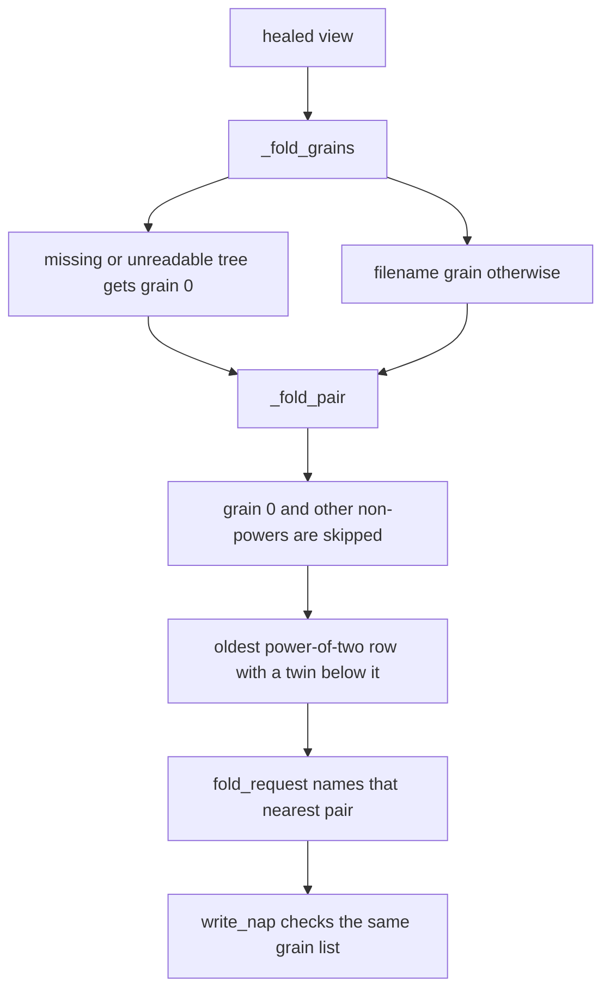

# TASK ARCHIVE: middle-orphans

## SUMMARY

Equal-neighbor fold stranded every row that sat before a bigger newer row. A merge, a late note, a zipper reopen, or surgery could build that wall, and then those wake lines never folded again. The picker is now skip fold, oldest pair first: the oldest power-of-two row that has a same-grain row anywhere below it, paired with the nearest such row. `nap` accepts that pair and refuses the rest. Wake sorts opened rows by date. Legacy packs whose grain is not a power of two stay listed and are never opened.

A review of [PR #87](https://github.com/Texarkanine/SumMem/pull/87) then found a second stall: a nap whose children file is missing or unreadable still counted by its filename grain, so every later `note` asked for the same pair. That row now has fold grain 0. It stays listed, it is never requested, and it never blocks a pair of good rows. Recovery of the file belongs to the operator through git.

The Level 3 reflection stands. The review fix was a Level 1 rework on the same branch. QA passed both times. The suite is 421 tests, green on py311–py314. PR #87 is open.

## REQUIREMENTS

From the project brief. The operator is someone whose repository is written by several agents at once. The fold request must keep compressing the listing no matter how merges interleave the rows, so that no wake line is stranded forever and recent notes stay verbatim, the way they do with a single writer.

1. **Fold picker.** When the view is over budget, `fold_request` names the oldest row that has a row of the same grain anywhere below it, paired with the nearest such row. It returns no request only when no two power-of-two rows share a grain. Rows whose grain is not a power of two are never named.
2. **`nap` pair rule.** `nap` accepts two view rows of the same grain with no row of that grain between them, even when they are not neighbors. It refuses unequal grains. It refuses a same-grain pair with a nearer same-grain row between them. It keeps the earlier refusals and their order: range token, unknown id, unreadable pack, overlapping packs.
3. **No new non-power-of-two packs.** No code path writes a pack whose grain is not a power of two.
4. **Wake order.** When wake opens packs in memory (view shorter than budget), the printed rows are sorted by each row's oldest note, so an opened pack's newer child lands at its own date.
5. **Legacy packs.** A pack already on disk whose grain is not a power of two is never opened on disk, never requested, and does not stop other rows from folding. Wake may still split it in memory for display when the view is under budget.
6. **Self-heal.** Stores that already have walls heal through the normal fold requests. No migration script.
7. **Docs.** Help text, README, architecture, theory, and `memory-bank/systemPatterns.md` describe the new rule.

Constraints that bound the design: no on-disk format change; captions only through the normal fold cascade; wake stays wait-free; the script stays the only writer; Python 3.11 floor, standard library only, one shebang file; today's single-writer behavior is preserved exactly.

Operator decisions of 2026-10-06: never write a non-power-of-two pack; skip fold with oldest pair first; `nap` takes same grain and nearest; wake sorts opened rows by date; legacy non-power-of-two packs are not opened.

**Rework (2026-10-11).** A nap whose `.tree` is missing or will not parse must be ineligible for folding, the same way a non-power-of-two pack is. It stays listed. It is never requested. It never counts as a nearer same-grain row. The script does not repair or delete the file.

Acceptance: the middle-orphan stranding tests pass; unequal naps are refused; a healthy listing still folds oldest pair first; new tests cover the `nap` pair rule, wake's expanded row order, and a seeded multi-writer property; pre-existing tests pass, with retargets limited to the ones the plan named; `tox run-parallel` is green on py311–py314; the docs no longer say folds need neighbors.

## IMPLEMENTATION

### What was wrong

`fold_request` took the oldest two neighbors with the same grain. That works only while grains never rise from an older row to a newer one, which a single writer guarantees. A **wall** is an older row sitting next to a bigger newer one. The row before a wall can never meet an equal neighbor again, because new notes land at the end and the row after the wall only grows. That row, and everything older, become dead wake lines.

Use-case that started the work: `main` holds `[8, 4, 2, 1]` and the 1 is `foo`. Two branches that never saw `foo` record later notes and fold them. After merge the listing is `[8, 4, 2, 1, 2, 2]`. The next folds give `[8, 4, 2, 1, 4]`: over budget, no request, and `foo` plus everything older never folds again. A late note stamped before a pack `main` already folded, a zipper reopen, `surgery.py` excising one note, or a legacy odd-grain pack can each build the same wall.

### Fold picker

Six rules were simulated on the real driver: 4 writers, 1,500 notes, merges at 8% per note, two seeds, budget 32. Values below are seed 7 · seed 11.

| Rule | Stalls over budget | Powers of two | One writer unchanged | Notes above an older note | Recent verbatim |
|---|---|---|---|---|---|
| Today, equal neighbors | 76/113 · 101/119 merges | yes | yes | 807 · 802 | 1 · 1 |
| Unequal fold (older < 2 × newer) | no | no (packs of 3, 35, 1,371) | yes | — | — |
| Skip, smallest grain first | no | yes | no (0 recent notes verbatim) | — | 0 for one writer |
| Skip, oldest pair first | 0 · 0 | yes | yes | 179 · 103 | 28 · 28 |
| Pull-back only | yes at budget 8 (71/113); strands `[4, 1]` before a merged 8-pack | yes | yes | 965 · 1,251 | 21 · 14 |
| Fewest walls, any jump | no | yes | yes | 209 · 191 | 28 · 20 |

**Selected: skip fold, oldest pair first.** It was the only option that never stalled, kept recent notes verbatim, and listed the fewest notes above older ones in both seeds. On a listing whose grains never rise, equal grains sit together, so this choice is exactly today's neighbors. It is a conservative extension, not a new one-writer policy.

With only power-of-two grains, a view where no two rows share a grain is a binary number, so it has at most ⌊log₂ N⌋ + 1 rows. Over a 32-line budget a pair always exists until about 8.6 billion notes, plus one extra row per legacy odd pack. "No row strands forever" is argued and simulated. It is not a proof. The suite's seeded property test is the ratchet.

Tradeoff the operator accepted: a nap's leaves are no longer guaranteed to be contiguous in time. At budget 32, 7–12% of notes are listed above an older note, by at most 0.2× the size of their own pack. Concurrent writers already broke strict chronology, because a merged branch's pack already spans `main`'s notes. Misordering accumulates while a wall stands, because every later block that folds past a stranded row jumps over it again. One larger jump early beats many small jumps later. That is why pull-back lost on its own metric. Smallest-grain-first folds the newest notes first and destroys the recency gradient.

One writer under the old rule, measured over 5,000 notes: grains never rise, each grain ≥ 2 appears at most twice, and at most one grain is doubled at a time. Oldest-pair-first keeps that shape after 87–97% of merges, and in 85–97% has exactly the grains a single writer would have with that many notes. It never showed more than 2 copies of a grain. The old rule kept the shape after 2–11% of merges, with up to 28 copies of one grain.

A local scan on 2026-10-06 of 22 stores in 11 repositories found zero non-power-of-two packs, listed or nested, and zero walls in the four stores that had folded.

The research harness lived under `memory-bank/active/creative/fold-research/` and drove the real `summem` in process, swapping only the pair choice. It is gone with the rest of the creative files. The numbers above are the record.

### `nap` pair rule

`write_nap` used to accept two neighbors of any grain. The new picker names pairs that are not neighbors, and the operator forbids non-power-of-two packs.

| Option | Why it lost or won |
|---|---|
| Same grain, nearest | Selected. Accepts every picker request. Refuses a pair that would jump a closer partner. |
| Same grain, any distance | Also accepts picker requests, and also lets a fresh note land at the oldest position. |
| Neighbors only, plus same grain | Refuses the skip pairs, so the stall returns. |
| Neighbors only, any grain | Today's rule. Writes odd packs. |

Check order inside `write_nap`, after the ids resolve: load both children, overlap, equal grain, power of two, nearest. Grain and nearest run after the children load because four existing tests expect `unknown id`, `unreadable pack`, or `overlapping packs` from a note napped with a pack. A prototype that checked grain first failed all four.

Refusal text states the problem: `not two rows`, `not the same grain`, `not a power of two`, `a nearer row of that grain sits between them`. A merge that lands between a fold request and the agent's `nap` can put a row between the pair. The nap is refused, and the next `note` asks again. That is the same class as the old `not adjacent`.

`_adjacent_nodes` is gone. `_pair_nodes` returns the closest pair of distinct rows when several rows share an id, older pair on a tie. `_is_pow2`, `_nearest_twin`, and `_fold_pair` are shared by the picker and `write_nap`, so the requested pair is accepted by construction. `nap` is not narrowed to the picker's single pair. Any nearest same-grain power-of-two pair is legal. That was the operator's decision.

### Wake order and legacy packs

When the view is shorter than the budget, `expand_frontier` still opens the newest expandable pack in memory. After each split it sorts the frontier by each row's oldest note (`ProjectedNode.seq`, the `{stamp}-{rand}` key). A seconds-only stamp would leave same-second rows in arbitrary order. Unexpanded listings are already in filename order, which is oldest-note order, so they do not move. At or over budget, wake opens nothing. The two children of an opened pack are no longer printed next to each other. `nap` takes view ids, and `zoom` prints a pack's own children, so nothing depended on them staying adjacent on the page.

Legacy odd packs are never opened. Opening them on reach, opening them in heal, and a one-time migrate script were considered. Never-open costs nothing on every store that was scanned, requests no caption outside the cascade, and cannot flatten a long `16+1+1+…` pack into one loose note per leaf. The tradeoff: a store that holds such a pack keeps it as one extra wake line. If a real store ever needs it gone, the remedy is an operator-run script, not an automatic path. `heal_view` was left alone.

One legacy odd row has no twin and would be skipped anyway. Two legacy rows of the same odd grain would share a grain. Both the picker and `nap` refuse that pair, so two 6-packs cannot become a 12-pack. Once `nap` refuses unequal grains, the count of odd packs cannot grow through fold. Zipper and surgery can still reopen a nested odd pack the way they always could. None were nested on this machine.

### How it was built

Five units, tests before production code on the executable ones.

1. Fixtures. `fold_ids` only builds balanced packs. `plant_pack` writes a legacy shape with no pairing policy. The two direct 2-pack-plus-note naps in `tests/test_branch_pack_merge.py` became `plant_pack`. Preflight run 1 had missed that fixture.
2. `nap`. Accept a nearest same-grain power-of-two pair. Refuse the rest in the pinned check order.
3. Picker. `fold_request` calls `_fold_pair` on the view's grains.
4. Wake. Set `ProjectedNode.seq` and sort opened rows after each split.
5. Docs. Help, README, architecture, theory, and `systemPatterns.md`. The one-writer walk in the architecture doc still says neighbors, because on a listing that never rises the pair is still the oldest neighbors. The zipper picture that assumed an unequal nap was redrawn as two grain-8 packs.

`surgery.py` only prints `fold_request` after an excision, so surgery's stranded rows are requested with no surgery change. `migrate.py` was not touched.

### Review rework

PR #87 review (cursor[bot], https://github.com/Texarkanine/SumMem/pull/87#discussion_r4242528865): a nap whose `.tree` is missing or will not parse still counted by `node.leaves`, which comes from the filename. Oldest-pair-first makes that broken nap the request almost every time it has a later twin. `write_nap` then fails (`unknown id` / `unreadable pack`), and every later `note` asks for the same pair. The nearest-twin check counted it too, so it blocked a valid pair of good rows around it. On `main` the same stall happened only when the broken nap was already in the oldest adjacent pair.

`_fold_grains` returns each row's grain, and 0 for a nap whose children file is missing or whose bytes will not parse (`loads_tree` raising `_TREE_PARSE_ERRORS`, or `tree_path is None`). 0 is not a power of two, so `_fold_pair` skips the row and `_nearest_twin` never counts it. `fold_request` and the nearest check in `write_nap` both consume that list. The row stays in the view. The creative notes had already named this as pre-existing and out of scope; the review brought it in.

A second review comment, about `_replace` and `seq`, was dismissed. `_replace` rebuilds from `__slots__`.

Key files: `summem`, `tests/test_middle_orphans.py`, `tests/test_nap_reject.py`, `tests/test_fold.py`, `tests/test_nap.py`, `tests/test_wake_expand.py`, `tests/gitutil.py`, `tests/test_branch_pack_merge.py`, `docs/architecture/index.md`, `memory-bank/systemPatterns.md`. Vendored copies `.summem/summem` and `dogfood/.summem/summem` match `summem`.

## TESTING

Red regression tests landed before the plan: `tests/test_middle_orphans.py` and `tests/test_nap_reject.py`. Baseline before the build was 7 failed, 395 passed.

Preflight run 1 was FAIL (fixable): the plan did not name the unequal nap in `test_two_branch_overlapping_packs_heal_on_next_mutate`. Run 2 built Units 1–4 in scratch copies outside the worktree. With the fixture fix, that test stayed green. Unchanged code: 7 failed, 395 passed. Units 1–4: 5 failed, 397 passed, and every failure was a retarget the plan named. For one writer, the new picker chose the same pair as the neighbors-only rule at all 6,404 fold steps (budgets 1–32, up to 200 notes). A three-writer model of the property test stalled on the unchanged driver and did not stall on the new rule. Preflight result: PASS WITH ADVISORY.

Advisories adopted before production code: the stranding-test count is five; `_pair_nodes` returns indices; `write_nap` names which grain it compares and checks that the digest count is a power of two; the node form of the old equal-grain oracle stays for its callers; the Unit 1 gate is 395 passed; Requirement 5 says never opened on disk. The brief's "no two power-of-two rows" wording and the docs sweep (`adjacen|neighbo`, including `systemPatterns.md` and the architecture page) went in with that rework. One advisory was left for the operator and not built: a bounded exhaustive pure-model check of the fold rule next to the many-writers test.

Build verification: `tox run-parallel` green on py311–py314. py311 reported 417 passed. Level 3 QA reviewed `main...HEAD` and re-ran `tox -e py311` (417 passed). PASS, with three non-blocking advisories: test names that still say adjacent, refusal text that states the problem only, and the overlapping-leaves check together with the digest-count check. The plan asked for both checks and for problem-only messages. No debris in the diff. Docs, README, help, and `systemPatterns.md` were searched for "adjacent" and "neighbor". The remaining hits are the single-writer walk, the wall definition, and the retained test oracle.

The rework added four tests, red first: `test_fold_request_skips_a_pack_whose_children_file_is_broken` for a missing file and for an unreadable file (grains 2, 1, 2, 1, 1 with the oldest 2 broken: the request names the two oldest 1s and `nap` accepts the Run: line), and `test_nap_pairs_across_a_same_grain_pack_whose_children_file_is_broken` for the same two breakages (grains 2, 2, 2 with the middle broken: the outer two fold and the broken row stays listed). `tox run-parallel` green again. Rework QA reviewed `a60d9d0..HEAD` and re-ran `tox -e py311`: 421 passed. PASS.

Rework advisories, none blocking:

- `_fold_grains` repeats `_as_child`'s children-file load. Wrapping `_as_child` and mapping `ValueError` to 0 would keep the picker and `nap` in step by construction. They agree today: a missing file and a directory both raise `OSError` and are caught.
- A nap whose `.tree` parses but whose digest count differs from its filename grain would still be requested, and `nap` would refuse it with "not a power of two". That takes a hand edit. It is outside the review finding.
- `test_fold.py` has a helper for breaking the children file. `test_nap.py` inlines the same four lines.
- An over-budget `note` or `nap` now reads and parses every nap's `.tree`. The cost is bounded by view size. Wake does not call `fold_request`, so the wait-free constraint holds.

Identical notes share a digest, so closest-pair is pinned on `_pair_nodes`, not by a successful `nap` of one id with itself. The many-writers test was about 115 seconds a seed while each note restarted a zoom walk, and 3.17 seconds once one walk collected the reachable text. The assertion did not change. The research scripts called `_adjacent_nodes` after the product had deleted it. They were never on the test path.

## LESSONS LEARNED

- Neighbors-only fold and this picker are the same function on a listing whose grains never rise. The one-writer picture in the architecture doc can keep saying neighbors for that walk.
- Two notes with the same text share an id and a digest. Once they are two rows, `write_nap` of that id twice is "overlapping packs". A closest-pair preference has to be tested on `_pair_nodes`.
- Checking grain before loading children flips the older refusal tests. The new checks belong after `_as_child` and the overlap check.
- Pure pull-back strands rows forever. A young `main` of `[4, 1]` followed by a merged 8-pack never heals, and misordering piles up while the wall stands.
- A property test that restarts a tree walk per item can pass and still be unusable. One walk of the view was the same assertion at a fraction of the time.
- The picker and the nearest-twin check must agree on which rows count. One grain list feeds both, so a row the picker skips cannot block a pair in `nap`.
- Attribute a prototype failure by its error. An unequal-nap fixture was first lumped in with `fold_ids` fallout by guess. The real breakdown was 11 through `fold_ids`, 1 direct nap in `test_branch_pack_merge.py`, and 4 zipper tests.

## PROCESS IMPROVEMENTS

- A preflight that builds the plan in scratch, and reports the exact failing names, is cheaper than discovering those failures one red test at a time. Run 1's missed fixture never reached the production TDD loop.
- The creative simulation is what made oldest-pair-first a decision. The build's one-writer oracle is that same comparison moved into the suite.
- If a later store strands under this rule, re-enter the plan. Do not special-case the picker.

## TECHNICAL IMPROVEMENTS

Left on purpose:

- The exhaustive two-writer model next to the many-writers test. The operator was offered it and the planned fix was what got built. "No row strands forever" stays a tested rule, not a proof.
- Level 3 QA's three advisories: adjacent-named tests, problem-only refusal text, and the two `write_nap` checks the plan required.
- The four rework advisories in TESTING. The residual stall (a parse-valid `.tree` whose digest count disagrees with the filename) is the one that could still stop fold, and it takes a hand edit.

`productContext.md` and `techContext.md` needed no edit. `systemPatterns.md` states the fold rule, the wake sort, and that a nap with a missing or unreadable `.tree` is never requested and never a nearer row.

## NEXT STEPS

[PR #87](https://github.com/Texarkanine/SumMem/pull/87) is open and mergeable (`fix: fold the oldest same-grain pair across a wall`). This archive does not merge it.

None of the advisories block that. A store that strands under this rule, or a hand-edited `.tree` whose digest count disagrees with its filename, is a new task.
